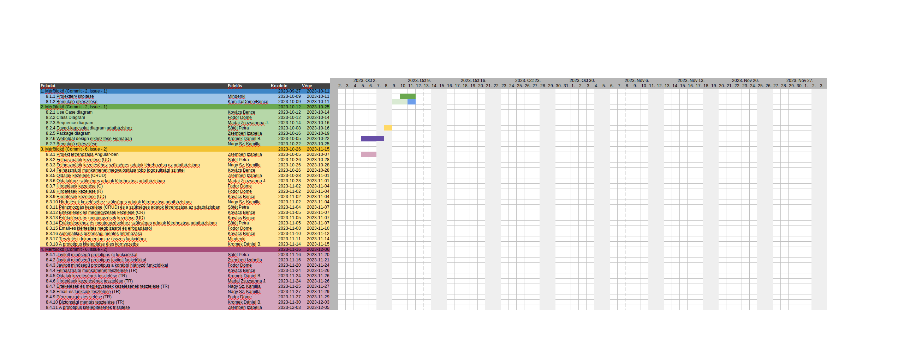

# `Rendszerfejlesztés projektterv 2023_ib153i-11_d`

## 1. Összefoglaló 

`Projektünk alapja a Fiverr nevű külföldi oldal, amit hazánkban kevesen ismernek. Ezzel az oldallal próbáljuk meg betölteni azt a piaci rést, ami jelenleg a magyar szabadúszó piacon általánosnak mondható. Projektünk célja egy olyan weboldalt létrehozni, ami egyaránt nyújt helyet a szabadúszó munkavállalóknak és munkások keresésének.`

## 2. A projekt bemutatása

`Ez a projektterv egy Fiverr-alapú projektet mutat be, neve: JobCompass, amely 2023-09-27-től 2023-12-06-ig tart, összesen 70 napig, a projekten 7 fejlesztő fog dolgozni, az elvégzett feladatokat pedig négy alkalommal fogjuk prezentálni, ezáltal biztosítjuk a projekt előrehaladását.`


### 2.1. Rendszerspecifikáció

`A rendszerünknek képesnek kell lennie arra, hogy elsősorban a felhasználó könnyedséggel tudjon navigálni az oldalon. A rendszer célja az, hogy a felhasználó tudjon számára megfelelő informatikai munkaerőt találni, azáltal, hogy létrehozunk egy számára könnyedén kezelhető és átlátható webalkalmazást. Ezen felül a rendszernek képesnek kell lennie arra, hogy befogadja az új munkaerő jelentkezését (regisztráció kezelése, bejelentkezés kezelése, a jelentkezett ember személyes leírását, milyen típusú informatikai háttérrel jelentkezik). A webalkalmazásnak ezeket az adatokat fel kell használnia a jelentkező rendszer szerinti besorolásához. A felhasználónak képesnek kell lennie a rendszeren belül rákeresni és rátalálni egy másik felhasználóra, illetve üzenetet küldeni az általa kiválasztott személynek.`


### 2.2. Funkcionális követelmények

 - `Felhasználók kezelése (önmagát hirdető jelentkező, munkaerő kereső, admin) (CRUD)`
 - `Felhasználói munkamenet megvalósítása több jogosultsági szinttel`
 - `Jelentkezések kezelése (CRUD)`
 - `Keresések kezelése`
 - `Személyes információk (pl.: elérhetőség) tárolása`
 - `Személyes leírások kezelése (CRUD)`
 - `Üzenetírás lehetősége a munkaerőnek`
 - `Címkék létrehozása a munkaerőhöz, keresés címkék alapján`


### 2.3. Nem funkcionális követelmények

 - `A kliens oldal böngészőfüggetlen legyen`
 - `Reszponzív és igényes megjelenés`
 - `Az érzékeny adatokat biztonságosan tároljuk`
 - `Az oldal könnyen kezelhető és átlátható`
 - `Az oldal gyorsan fut`
 - `Modern és friss megjelenés`


## 3. Költség- és erőforrás-szükségletek

Az erőforrásigényünk összesen `86.5` személynap, átlagosan `12.5` személynap/fő.

A rendelkezésünkre áll összesen `7 * 70 = 490` pont.


## 4. Szervezeti felépítés és felelősségmegosztás

A projekt megrendelője `Dr. Márkus András`. A `JobCompass` projektet a projektcsapat fogja végrehajtani, amely `jelenleg hét fejlesztőből áll. A csapatban pályakezdő webprogramozók vannak.`
 - `Fodor Döme (1 év egyetemi tapasztalat, 1 év ipari tapasztalat)`
 - `Kovács Bence (1 év tapasztalat - PHP, Java, Python)`
 - `Zsemberi Izabella (1 év tapasztalat - Javascript, Angular, HTML, PHP)`
 - `Nagy Kamilla (2 év tapasztalat - HTML, CSS, Javascript, PHP, SQL, 1 év: Java, Python)`
 - `Kromek Dániel (2 év tapasztalat - HTML, CSS, Javascript, git, 1 év tapasztalat: TypeScript, Angular)`
 - `Madai Zsuzsanna Jusztina (több mint 3 év tapasztalat))`
 - `Sötét Petra (több mint 3 év tapasztalat)`


### 4.1 Projektcsapat

A projekt a következő emberekből áll:

| Név                        | Pozíció          |   E-mail cím (stud-os)        |
|----------------------------|------------------|-------------------------------|
| `Fodor Döme`               | Projektmenedzser | `h258792@stud.u-szeged.hu`    |
| `Kovács Bence`             | Projekt tag      | `h266039@stud.u-szeged.hu`    |
| `Kromek Bálint Dániel`     | Projekt tag      | `h266845@stud.u-szeged.hu`    |
| `Zsemberi Izabella`        | Projekt tag      | `h270872@stud.u-szeged.hu`    |
| `Nagy Szilvia Kamilla`     | Projekt tag      | `h879779@stud.u-szeged.hu`    |
| `Sötét Petra`              | Projekt tag      | `h164941@stud.u-szeged.hu`    |
| `Madai Zsuzsanna Jusztina` | Projekt tag      | `h768437@stud.u-szeged.hu`    |

## 5. A munka feltételei

### 5.1. Munkakörnyezet

A projekt a következő munkaállomásokat fogja használni a munka során:

 - `Dell Inspiron 5558 laptop (CPU: i5 5200U, RAM: 8 GB, GPU: Nvidia 920M)`
 - `Asztali számítógép (CPU: i3-9100F, RAM: 16GB, GPU: Nvidia GTX 960, Windows 10 Pro)`
 - `Acer Aspire 573g laptop (CPU: i3 5005U, RAM: 4 GB, GPU: Nvidia 920M)`
 - `Dell Precision M3800 (CPU: i7-4712HQ CPU, RAM: 16GB, GPU: Nvidia Quadro K1100M)`
 - `Asztali számítógép (CPU: i7 7700k, RAM: 16GB, GPU: Nvidia GTX1070)`
 - `MSI Katana GF66 laptop (CPU: i5-12500H, RAM: 16GB, GPU: Nvidia GeForce RTX 3050 Ti, OS: Windows 11 Pro)`
 - `Asztali számítógép (CPU: i3-9100F, RAM: 16GB, GPU: Nvidia GeForce GTX 1660, OS: Windows 11 Pro)`
 - `Acer Nitro 5 (CPU: i7-10750H, RAM: 16GB, GPU: Nvidia GeForce GTX 1650, OS: Windows 11 Pro)`
 - `Huawei Matebook 14 (CPU: i5-1135G7, RAM: 8GB, GPU: Intel)`
 - `Asztali számítógép (CPU: AMD Ryzen 5 5600X, RAM: 16GB, GPU: Nvidia GeForce RTX 4060, OS: Windows 11 Pro)`
 - `Lenovo Legion laptop (CPU: I7-9750H, RAM: 16GB, GPU: Nvidia GeForce GTX 1650 4GB, OS: Windows 11 Home)`

A projekt a következő technológiákat/szoftvereket fogja használni a munka során: 

 - `Git verziókövető (GitLab)`
 - `Angular a frontend fejlesztéshez`
 - `Figma design készítéshez`
 - `HTML/CSS/JavaScript (frontend)`
 - `Java/PHP (backend)`
 - `JetBrains IDE fejlesztőkörnyezetek`
 - `Visual Studio Code fejlesztőkörnyezet`
 - `Orace VM VirtualBox Xubuntu OS`


### 5.2. Rizikómenedzsment

| Kockázat                                    | Leírás                                                                                                                                                                                     | Valószínűség | Hatás  |
|---------------------------------------------|--------------------------------------------------------------------------------------------------------------------------------------------------------------------------------------------|--------------|--------|
| `Betegség`                                  | `Súlyosságtól függően hátráltatja vagy bizonyos esetekben teljes mértékben korlátozza a munkavégzőt, így az egész projektre kihatással van. Megoldás: a feladatok átcsoportosítása`        | `nagy`       | `erős` |
| `Kommunikációs fennakadás a csapattagokkal` | `A csapattagok között nem elégséges az információ áramlás, nem pontosan, esetleg késve vagy nem egyértelműen tájékoztatjuk egymást. Megoldás: még gyakoribb megbeszélések és ellenőrzések` | `kis`        | `erős` |


## 6. Jelentések

### 6.1. Munka menedzsment
`A munkát Fodor Döme koordinálja. Fő feladata, hogy folyamatosan egyeztessen a csapattagokkal az előrehaladásról és a fellépő problémákról, esetlegesen a megoldásban is segítséget nyújt a projekt csúszásának elkerülése végett. További feladata a heti szinten tartandó csoport gyűlések időpontjának és helyszínének szervezése, erről discordon/messengeren tájékoztatja a projekt csapatot.`


### 6.2. Csoportgyűlések

`A projekt hetente ülésezik, hogy megvitassák az azt megelőző hét problémáit, illetve hogy megbeszéljék a következő hét feladatait. A megbeszélésről minden esetben memó készül.`

`1. megbeszélés:`
 - `Időpont: 2021.09.15.`
 - `Hely: SZTE Irinyi épület - Szeged, Tisza Lajos krt. 103`
 - `Résztvevők: Fodor Döme, Kovács Bence, Kromek Bálint Dániel, Zsemberi Izabella,Nagy Szilvia Kamilla, Sötét Petra, Madai Zsuzsanna Jusztina`
 - `Érintett témák: Ismerkedés, ötletelés`

`2. megbeszélés:`
 - `Időpont: 2023.09.21.`
 - `Hely: Cool Club - Szeged, Londoni krt. 22`
 - `Résztvevők: Fodor Döme, Kovács Bence, Kromek Bálint Dániel, Zsemberi Izabella, Sötét Petra, Madai Zsuzsanna Jusztina`
 - `Érintett témák: Projekt téma kitalálása. A projektben használt technológiák rögzítése, a projektterv áttekintése, szerepkörök és vállalások kiosztása`

`3. Megbeszélés:`
 - `Időpont: 2023.09.28.`
 - `Hely: SZTE TIK – Szeged`
 - `Résztvevők:  Fodor Döme, Kovács Bence, Kromek Bálint Dániel, Zsemberi Izabella,Nagy Szilvia Kamilla, Sötét Petra, Madai Zsuzsanna Jusztina`
 - `Érintett témák: Egyeztetések, látványtervről való egyeztetés`

`4. Megbeszélés:`
 - `Időpont: 2023.10.05.`
 - `Hely: SZTE TIK – Szeged`
 - `Résztvevők: Fodor Döme, Kovács Bence, Kromek Bálint Dániel, Zsemberi Izabella, Sötét Petra`
 - `Érintett témák: 1. mérföldkő feladatainak részletes megbeszélése, kiosztása; a megkezdett feladatok átnézése`

### 6.3. Minőségbiztosítás

Az elkészült terveket a terveken nem dolgozó csapattársak közül átnézik, hogy megfelel-e a specifikációnak és az egyes diagramtípusok összhangban vannak-e egymással. A meglévő rendszerünk helyes működését a prototípusok bemutatása előtt a tesztelési dokumentumban leírtak végrehajtása alapján ellenőrizzük és összevetjük a specifikációval, hogy az elvárt eredményt kapjuk-e. További tesztelési lehetőségek: unit tesztek írása az egyes modulokhoz vagy a kód közös átnézése (code review) egy, a vizsgált modul programozásában nem résztvevő csapattaggal. Szoftverünk minőségét a végső leadás előtt javítani kell a rendszerünkre lefuttatott kódelemzés során kapott metrikaértékek és szabálysértések figyelembevételével.
Az alábbi lehetőségek vannak a szoftver megfelelő minőségének biztosítására:
- Specifikáció és tervek átnézése (kötelező)
- Teszttervek végrehajtása (kötelező)
- Unit tesztek írása (választható)
- Kód átnézése (választható)

### 6.4. Átadás, eredmények elfogadása

A projekt eredményeit a megrendelő, `Dr. Márkus András` fogja elfogadni. A projektterven változásokat csak a megrendelő írásos engedélyével lehet tenni. A projekt eredményesnek bizonyul, ha specifikáció helyes és határidőn belül készül el. Az esetleges késések pontlevonást eredményeznek. 
Az elfogadás feltételeire és beadás formájára vonatkozó részletes leírás a következő honlapon olvasható: https://okt.inf.szte.hu/rf1/

### 6.5. Státuszjelentés

Minden mérföldkő leadásnál a projekten dolgozók jelentést tesznek a mérföldkőben végzett munkájukról a a megadott sablon alapján. A gyakorlatvezetővel folytatott csapatmegbeszéléseken a csapat áttekintik és felmérik az eredményeket és teendőket. Továbbá gazdálkodnak az erőforrásokkal és szükség esetén a megrendelővel egyeztetnek a projektterv módosításáról.

## 7. A munka tartalma

### 7.1. Tervezett szoftverfolyamat modell és architektúra

`A szoftver fejlesztése során az agilis fejlesztési modellt alkalmazzuk, mivel a fejlesztés során nagy hangsúlyt fektetünk a folyamatos kommunikációra. A fejlesztés során a szoftver specifikáció rugalmasan változhatnak, és ezzel a módszertannal tudunk a leggyorsabban alkalmazkodni az új elvárásokhoz.`

`A webalkalmazás az MVC (model-view-controller) felépítést követi, a szerver és a kliens függetlenek, csupán API végpontok segítségével kommunikálnak..`


### 7.2. Átadandók és határidők

A főbb átadandók és határidők a projekt időtartama alatt a következők:


| Szállítandó |                 Neve                                                        |   Határideje  |
|:-----------:|:---------------------------------------------------------------------------:|:-------------:|
|      D1     |      Projektterv és Gantt chart, prezentáció, egyéni jelentés               | `2023-10-11`  |
|    P1+D2    |      UML, adatbázis- és képernyőtervek, prezentáció, egyéni jelentés        | `2023-10-25`  |
|    P1+D3    |      Prototípus I. és tesztelési dokumentáció, egyéni jelentés              | `2023-11-15`  |
|    P2+D4    |      Prototípus II. és frissített tesztelési dokumentáció, egyéni jelentés  | `2023-12-06`  |


## 8. Feladatlista

A következőkben a tervezett feladatok részletes összefoglalása található.


### 8.1. Projektterv (1. mérföldkő)

Ennek a feladatnak az a célja, hogy `megvalósításhoz szükséges lépéseket, az erőforrásigényeket, az ütemezést, a felelősöket és a feladatok sorrendjét meghatározzuk, majd vizualizáljuk Gantt diagram segítségével.`

Részfeladatai a következők:

#### 8.1.1. Projektterv kitöltése

Felelős: `Mindenki`

Tartam:  `4 nap`

Erőforrásigény:  `1 személynap/fő`


#### 8.1.2. Bemutató elkészítése

Felelős: `Kovács Bence, Fodor Döme, Nagy Sz. Kamilla`

Tartam:  `2 nap`

Erőforrásigény:  `0.5 személynap`


### 8.2. UML és adatbázis- és képernyőtervek (2. mérföldkő)

Ennek a feladatnak az a célja, hogy `a rendszerarchitektúrát, az adatbázist és webalkalmazás kinézetét megtervezzük.`

Részfeladatai a következők:

#### 8.2.1. Use Case diagram

Felelős: `Kovács Bence`

Tartam:  `1 nap`

Erőforrásigény:  `1 személynap`

#### 8.2.2. Class diagram

Felelős: `Fodor Döme`

Tartam:  `2 nap`

Erőforrásigény:  `1 személynap`

#### 8.2.3. Sequence diagram

Felelős: `Zsemberi Izabella`

Tartam:  `4 nap`

Erőforrásigény:  `2 személynap`

#### 8.2.4. Egyed-kapcsolat diagram adatbázishoz

Felelős: `Sötét Petra & Nagy Sz. Kamilla`

Tartam:  `1 nap`

Erőforrásigény:  `2 személynap`

#### 8.2.5. Package diagram

Felelős: `Madai Zsuzsanna J.`

Tartam:  `3 nap`

Erőforrásigény:  `1.5 személynap`

#### 8.2.6. Weboldal Design Figmában

Felelős: `Kromek Bálint Dániel`

Tartam:  `3 nap`

Erőforrásigény:  `2 személynap`

#### 8.2.7. Bemutató elkészítése

Felelős: `Nagy Sz. Kamilla`

Tartam:  `2 nap`

Erőforrásigény:  `0.5 személynap`


### 8.3. Prototípus I. (3. mérföldkő)

Ennek a feladatnak az a célja, hogy `egy működő prototípust hozzunk létre, ahol a vállalt funkcionális követelmények nagy része már prezentálható állapotban van.` 

Részfeladatai a következők:

#### 8.3.1. Projekt létrehozása Angular-ban

Felelős: `Zsemberi Izabella`

Tartam:  `3 nap`

Erőforrásigény:  `2 személynap`

#### 8.3.2. Felhasználók kezelése (CRUD)

Felelős: `Kovács Bence`

Tartam:  `3 nap`

Erőforrásigény:  `1.5 személynap`

#### 8.3.3. Felhasználók kezeléséhez szükséges adatok létrehozása az adatbázisban

Felelős: `Madai Zsuzsanna J.`

Tartam:  `3 nap`

Erőforrásigény:  `1 személynap`

#### 8.3.4. Felhasználói munkamenet megvalósítása több jogosultsági szinttel

Felelős: `Sötét Petra`

Tartam:  `3 nap`

Erőforrásigény:  `2 személynap`

#### 8.3.5. Oldalak stílusa frontendben 

Felelős: `Kromek Dániel`

Tartam:  `3 nap`

Erőforrásigény:  `2 személynap`

#### 8.3.6. Oldalak kezelése (CRUD)

Felelős: `Kovács Bence`

Tartam:  `5 nap`

Erőforrásigény:  `2.5 személynap`

#### 8.3.7. Oldalakhoz szükséges adatok létrehozása az adatbázisban

Felelős: `Madai Zsuzsanna J.`

Tartam:  `5 nap`

Erőforrásigény:  `3 személynap`

#### 8.3.8. Hirdetések kezelése frontendben

Felelős: `Madai Zsuzsanna J. `

Tartam:  `5 nap`

Erőforrásigény:  `4 személynap`

#### 8.3.9. Hirdetések kezelése (C)

Felelős: `Kromek Dániel `

Tartam:  `3 nap`

Erőforrásigény:  `2 személynap`

#### 8.3.10. Hirdetések kezelése (R)

Felelős: `Zsemberi Izabella`

Tartam:  `3 nap`

Erőforrásigény:  `1 személynap`

#### 8.3.11. Hirdetések kezelése (UD)

Felelős: `Kromek Dániel`

Tartam:  `3 nap`

Erőforrásigény:  `2 személynap`

#### 8.3.12. Hirdetések kezeléséhez szükséges adatok létrehozása az adatbázisban

Felelős: `Nagy Sz. Kamilla`

Tartam:  `3 nap`

Erőforrásigény:  `2 személynap`

#### 8.3.13. Pénzmozgás kezelése (CRUD) és a szükséges adatok létrehozása az adatbázisban

Felelős: `Sötét Petra`

Tartam:  `4 nap`

Erőforrásigény:  `2 személynap`

#### 8.3.14. Értékelések és megjegyzések létrehozása frontendben

Felelős: `Zsemberi Izabella`

Tartam:  `3 nap`

Erőforrásigény:  `2 személynap`

#### 8.3.15. Értékelések és megjegyzések kezelése (CR)

Felelős: `Kovács Bence`

Tartam:  `3 nap`

Erőforrásigény:  `2 személynap`

#### 8.3.16. Értékelések és megjegyzések kezelése (UD)

Felelős: `Kovács Bence`

Tartam:  `3 nap`

Erőforrásigény:  `2 személynap`

#### 8.3.17. Értékelésekhez és megjeggyzésekhez szükséges adatok létrehozása az adatbázisban

Felelős: `Nagy Sz. Kamilla`

Tartam:  `3 nap`

Erőforrásigény:  `2 személynap`

#### 8.3.18. Email-es kiértesítés megbízásról és elfogadásról

Felelős: `Fodor Döme`

Tartam:  `3 nap`

Erőforrásigény:  `2 személynap`

#### 8.3.19. Automatikus biztonsági mentés létrehozása

Felelős: `Fodor Döme`

Tartam:  `3 nap`

Erőforrásigény:  `2 személynap`

#### 8.3.20. Tesztelési dokumentum az összes funkcióhoz

Felelős: `Mindenki`

Tartam:  `4 nap`

Erőforrásigény:  `1 személynap/fő`

#### 8.3.21. A prototípus kitelepítése éles környezetbe

Felelős: `Sötét Petra`

Tartam:  `2 nap`

Erőforrásigény:  `1 személynap`


### 8.4. Prototípus II. (4. mérföldkő)

Ennek a feladatnak az a célja, hogy `az előző mérföldkő hiányzó funkcióit pótoljuk, illetve a hibásan működő funkciókat és az esetlegesen felmerülő új funkciókat megvalósítsuk. Továbbá az alkalmazás alapos tesztelése is a mérföldkőben történik az előző mérföldkőben összeállított tesztesetek alapján.`

Részfeladatai a következők:

#### 8.4.1. Javított minőségű prototípus új funkciókkal

Felelős: `Sötét Petra`

Tartam:  `5 nap`

Erőforrásigény:  `2.5 személynap`

#### 8.4.2. Javított minőségű prototípus javított funkciókkal

Felelős: `Zsemberi Izabella`

Tartam:  `6 nap`

Erőforrásigény:  `3 személynap`

#### 8.4.3. Javított minőségű prototípus a korábbi hiányzó funkciókkal

Felelős: `Fodor Döme`

Tartam:  `5 nap`

Erőforrásigény:  `3.5 személynap`

#### 8.4.4. Felhasználói munkamenet tesztelése (TR)

Felelős: `Nagy Sz. Kamilla`

Tartam:  `3 nap`

Erőforrásigény:  `1 személynap`

#### 8.4.5. Oldalak kezelésének tesztelése (TR)

Felelős: `Fodor Döme`

Tartam:  `3 nap`

Erőforrásigény:  `1.5 személynap`

#### 8.4.6. Hirdetések kezelésének tesztelése (TR)

Felelős: `Madai Zsuzsanna J.`

Tartam:  `3 nap`

Erőforrásigény:  `1 személynap`

#### 8.4.7. Értékelések és megjegyzések kezelésének tesztelése (TR)

Felelős: `Zsemberi Izabella`

Tartam:  `3 nap`

Erőforrásigény:  `1.5 személynap`

#### 8.4.8. Email-es funkciók tesztelése (TR)

Felelős: `Nagy Sz Kamilla`

Tartam:  `3 nap`

Erőforrásigény:  `1.5 személynap`

#### 8.4.9. Pénzmozgás tesztelése (TR)

Felelős: `Kromek Dániel`

Tartam:  `3 nap`

Erőforrásigény:  `1.5 személynap`

#### 8.4.10. Biztonsági mentés tesztelése (TR)

Felelős: `Kovács Bence`

Tartam:  `4 nap`

Erőforrásigény:  `1.5 személynap`

#### 8.4.11. A prototípus kitelepítésének frissítése

Felelős: `Madai Zsuzsanna J.`

Tartam:  `1 nap`

Erőforrásigény:  `0.5 személynap`

## 9. Részletes időbeosztás



## 10. Projekt költségvetés

```
Az egyes leadások alkalmával rögzített erőforrásigényt, az elvállalt feladatok számát 
és az adott mérföldkőben végzett munkáért szerezhető pontszámot kell beírni minden emberre külön-külön.
Figyeljünk arra, hogy mivel mindenkinek minden mérföldkövön dolgoznia kell, ezért a 10.3-as táblázat
minden módosítható oszlopában legalább 1 pontnak szerepelni kell.
```
-

### 10.1. Részletes erőforrásigény (személynap)


| Név                    |   M1  |   M2  |   M3 |   M4  | Összesen |
|------------------------|-------|-------|------|-------|----------|
| `Sötét Petra`          | `1`   | `2`   | `6`  | `2.5` | `11.5`   |
| `Nagy Sz Kamilla`      | `1.5` | `2.5` | `5`  | `2.5` | `11.5`   |
| `Fodor Döme`           | `1.5` | `1`   | `5`  | `5`   | `12.5`   |
| `Kromek Bálint Dániel` | `1`   | `2`   | `7`  | `1.5` | `11.5`   |
| `Kovács Bence`         | `1.5` | `1`   | `9`  | `1.5` | `13`     |
| `Madai Zsuzsanna J.`   | `1`   | `1.5` | `9`  | `1.5` | `13`     |
| `Zsemberi Izabella`    | `1`   | `2`   | `6`  | `4.5` | `13.5`   |


### 10.2. Részletes feladatszámok

| Név                    |   M1  |   M2  |   M3 |   M4 | Összesen |
|------------------------|-------|-------|------|------|----------|
| `Sötét Petra`          | `1`   | `1`   | `4`  | `1`  | `7`      |
| `Nagy Sz Kamilla`      | `2`   | `2`   | `3`  | `2`  | `9`      |
| `Fodor Döme`           | `2`   | `1`   | `3`  | `2`  | `8`      |
| `Kromek Bálint Dániel` | `1`   | `1`   | `4`  | `1`  | `7`      |
| `Kovács Bence`         | `2`   | `1`   | `5`  | `1`  | `9`      |
| `Madai Zsuzsanna J.`   | `1`   | `1`   | `4`  | `2`  | `8`      |
| `Zsemberi Izabella`    | `1`   | `1`   | `4`  | `2`  | `8`      |

### 10.3. Részletes költségvetés

| Név                                 | M1      | M2       | M3       | M4       | Összesen  |
|-------------------------------------|---------|----------|----------|----------|-----------|
| Maximálisan megszerezhető pontszám  |  (7)    | (20)     | (35)     |  (28)    | 100% (70) |
| `Sötét Petra`                       | `4`     | `18`     | `30`     |  `18`    | 70        |
| `Nagy Sz Kamilla`                   | `7`     | `17`     | `30`     |  `16`    | 70        |
| `Fodor Döme`                        | `7`     | `13`     | `30`     |  `20`    | 70        |
| `Kromek Bálint Dániel`              | `4`     | `17`     | `32`     |  `17`    | 70        |
| `Kovács Bence`                      | `7`     | `13`     | `35`     |  `15`    | 70        |
| `Madai Zsuzsanna J.`                | `4`     | `15`     | `35`     |  `16`    | 70        |
| `Zsemberi Izabella`                 | `7`     | `14`     | `31`     |  `18`    | 70        |

Szeged, `2023-10-11`.